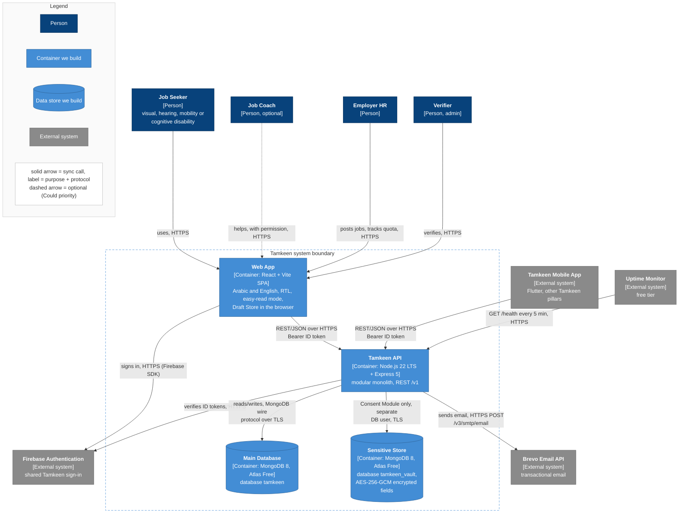

# Tamkeen

Tamkeen is our project for CSE4203 Principles of Software Architecture at AASTMT (Fall 2026). It's a job platform for people with disabilities in Egypt, with a quota dashboard for companies that have to meet the 5% hiring rule in Law 10/2018.

Team Success Enablers, supervised by Dr. Nada Mahmoud Hassan and Eng. Mohamed Fareh.

| Member | Student ID |
|---|---|
| Layal Ahmed Moussa | 231006574 |
| Mark Hany Elia | 231006804 |
| Sara Raef Abdelsalam | 231015069 |
| Youssef Sameh Elbendary | 231006239 |
| Zaid Mohamed Abdelrahman | 231006511 |

## The idea

By law, any company in Egypt with 20 or more employees has to give at least 5% of its jobs to persons with disabilities. A lot of companies get around it with "paper jobs", where someone is paid to stay home just so the number looks right. And on the other side, most job sites don't work properly with a screen reader, and plenty of them ask people for a diagnosis.

So we're building something for both sides. Job seekers make a profile around their skills and what helps them work (a screen reader, step-free access, written instructions), and we never ask for a diagnosis. Companies post jobs and list the accommodations they offer, and Tamkeen matches the two. When a company hires a verified person through the platform, its dashboard updates. For example, a company with 120 employees needs 6, so if it has 2 the dashboard shows a gap of 4.

The features themselves are simple. The interesting part (and the reason it works for this course) is the trade-offs: keeping the site secure without CAPTCHAs that block screen-reader users, protecting disability data under Law 151/2020, and staying reliable on free hosting that goes to sleep when nobody's using it.

## Milestones

| Milestone | What it is | Status |
|---|---|---|
| M1 | Proposal and architectural requirements | Submitted 23 Oct 2026 |
| M2 | Software Architecture Document | Submitted 27 Nov 2026 |
| M3 | Architectural prototype | In progress |
| M4 | Architecture evaluation and final presentation | Coming up |

The documents:

- [M1](docs/M1/successEnablers_tamkeen.pdf) (cleaned-up layout, same content as what we handed in)
- [M2](docs/M2/successEnablers_tamkeen.pdf)
- [M1 and M2 in one file](docs/successEnablers_tamkeen_M1_M2.pdf), if you want to read both together
- The PDF in the root folder is M1 exactly as we submitted it on 23 October.

## What's where

```
.
├── successEnablers_tamkeen.pdf          M1 as submitted
├── diagrams/                            M1 diagram sources
└── docs/
    ├── M1/, M2/                         milestone PDFs
    ├── successEnablers_tamkeen_M1_M2.pdf  both milestones in one file
    ├── elements.yaml                    the names we use for every box in every diagram
    ├── diagrams/                        M2 diagrams (Mermaid)
    ├── adr/                             our 7 architecture decisions
    ├── api/                             OpenAPI spec, event schemas and example events
    ├── traceability/                    the QAS-to-design matrix and a script that checks it
    └── tools/                           small helper scripts
```

## The architecture in short

A React web app talks to one Node.js + Express API. The API is a modular monolith: one thing to deploy, but split into modules that each own their own MongoDB collections. Disability data lives in a separate, encrypted database, and only the Consent Module can open it. Here's the container view from M2:



The reasoning behind each choice is in [docs/adr](docs/adr), and the full write-up is in the M2 PDF.

## Running the checks

We have a few checks for the docs: linting the API spec, validating the example events, and making sure every quality scenario traces to a design decision. GitHub runs them on every push to `docs/`. To run them yourself from the repo root:

```
npm install --prefix docs/tools
docs/tools/node_modules/.bin/redocly lint docs/api/openapi.yaml --config redocly.yaml
NODE_PATH=docs/tools/node_modules node docs/tools/validate-events.js
python3 docs/traceability/check_traceability.py
```

## Tech stack

MongoDB, Express, React and Node.js, with Firebase for sign-in (shared with the rest of the Tamkeen graduation project) and Brevo for email. Everything runs on free tiers: Vercel for the web app, Render for the API, MongoDB Atlas for the database.
