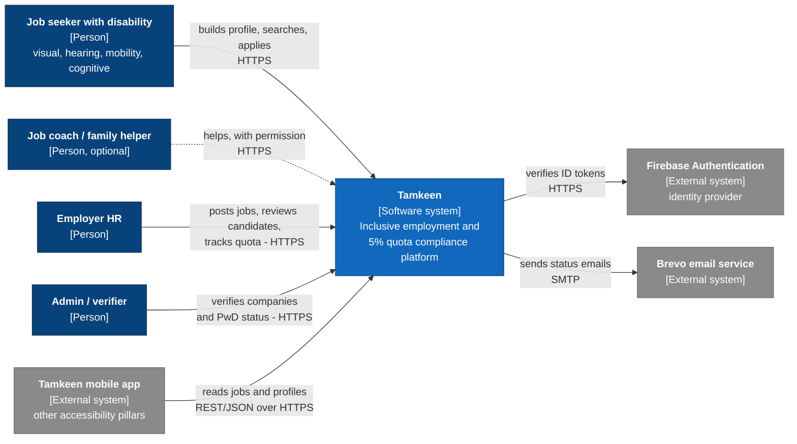
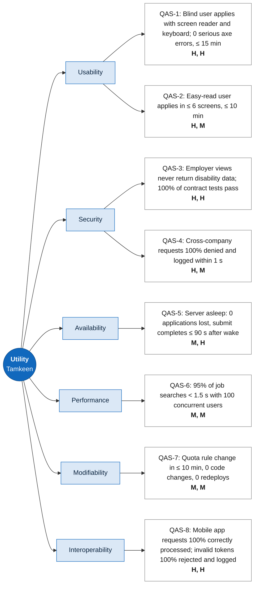

# Tamkeen

Inclusive employment and 5% quota compliance platform.

**Team:** Success Enablers
**Course:** CSE4203 Principles of Software Architecture, AASTMT (Fall 2026)
**Instructor:** Dr. Nada Mahmoud Hassan · **TA:** Eng. Mohamed Fareh

| Member | Student ID |
|---|---|
| Layal Ahmed Moussa | 231006574 |
| Mark Hany Elia | 231006804 |
| Sara Raef Abdelsalam | 231015069 |
| Youssef Sameh Elbendary | 231006239 |
| Zaid Mohamed Abdelrahman | 231006511 |

## What is Tamkeen?

Egypt's Law No. 10 of 2018 says any company with 20 or more employees has to give at least 5% of its jobs to persons with disabilities (PwDs). Many companies don't, or they hire people "on paper" and pay them to stay home. On the other side, most job sites don't work well with a screen reader, and a lot of forms ask for a diagnosis.

Tamkeen is a job platform for PwDs in Arabic and English. Job seekers list their skills and what they need to work well (a screen reader, step-free access, written instructions). We never ask for a diagnosis. Companies post jobs and say which accommodations they offer, and the platform matches the two. When a company hires a verified PwD, its quota dashboard updates: a company of 120 employees needs 6, so with 2 verified the dashboard shows a gap of 4.

The features are simple. What makes the architecture interesting is the trade-offs: security against usability (no CAPTCHAs or short time-outs for screen-reader users), privacy of disability data under Law 151/2020, and availability on free hosting that sleeps when idle.

## Milestones

| Milestone | What it covers | Status |
|---|---|---|
| M1 | Proposal and architectural requirements | Submitted 23 Oct 2026 |
| M2 | Software Architecture Document | Upcoming |
| M3 | Architectural prototype | Upcoming |
| M4 | Architecture evaluation and final presentation | Upcoming |

## Repository structure

```
.
├── README.md
├── successEnablers_tamkeen.pdf     # Milestone 1 document
└── diagrams/
    ├── context.mmd                 # Figure 1: C4 Level 1 system context
    └── utility-tree.mmd            # Figure 2: utility tree
```

## Diagrams

The diagram sources are Mermaid files. GitHub renders the copies below, and you can also open any `.mmd` file in [mermaid.live](https://mermaid.live) to view or edit it.

### Figure 1: System context (C4 Level 1)

Dark blue boxes are people, the blue box is our system, and grey boxes are external systems. Dashed arrows are optional (Could priority).



### Figure 2: Utility tree

Each scenario is rated (Importance, Difficulty) with H, M or L. Full six-part scenarios are in section 5 of the M1 PDF.



## Tech stack (planned)

MERN (MongoDB, Express, React, Node.js), Firebase Authentication for sign-in shared with the wider Tamkeen platform, and Brevo for email. Everything runs on free tiers.
